# 19. PC のレイアウト（操作の列と演出の列に分ける）— 設計案

状態：**案 0.2（2026-10-20：A 案をもとに作者の意見を反映。実装の確認待ち）**。実装はまだ。画像は、いまのコードに CSS を差し込んで撮った試作（`docs/img/19/`。右端の灰色は、共通基盤のチャットのドックの代わりに置いた 320px の箱）。

## 0.2 で決めた形（作者の意見 2026-10-20）

A 案（演出の列が左・操作の列が右）をもとに、操作の列を次の形にする。全体チャットは、PC ではどの画面でも右に出したままにする。

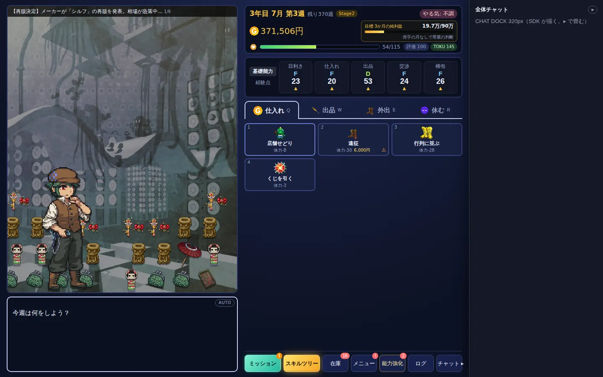

### 操作の列（上から）

| 場所 | 中身 |
|---|---|
| ヘッダー | 上の情報（年月週・所持金・目標・体力・評価・TOKU）。いまのまま |
| その下 | **能力を列で**：目利き・仕入れ・出品・交渉・梱包を 5 列に並べ、それぞれ名前・ランク・値・▲（いまの経験点で上げられる）を縦に出す。左の小さいタブで「基礎能力／経験点」を切り替えるのは、いまと同じ（経験点も 5 列）。押すと能力強化が開くのも同じ |
| 真ん中 | **行動のタブ**（下の「行動のタブ」） |
| フッター（いちばん下） | **ボタン群を操作の列いっぱいに 1 行で**：ミッション・スキルツリー（この 2 つは少し広く、色つき）・在庫・メニュー・能力強化・ログ・チャット。演出の最中も消さず、押せない見た目にする |

### 行動のタブ

- タブは「仕入れ・出品・外出・休む」の 4 つ。選んだタブの下に、その中の行動のカードを並べる（3 列）
  - いまの「分類のカード → 押すと中身」の 2 段を、1 段にする。◀ 戻るはなくなる
- **週のはじめは「仕入れ」が選ばれている**。同じ週の中では、最後に開いたタブのまま（行動のあとに仕入れへ戻らない）
- 「出品」のタブには、いまと同じく「在庫を出品（週は進まない）」のカードを先頭に出す。「休む」のタブは、休むのカード 1 枚
- タブには、いまの分類のカードと同じ印を出す：NEW、オークション開催、行動の数
- 「⟳ ルーティン」はタブの行の右端に、「出品枠あき…先に出品する ▶」の帯はカードの上に置く
- 夜は、タブの代わりに「夜」の見出しを出し、夜の行動と「寝る」をそのまま並べる（夜は分類がない）
- 体調不良のときは「休む」のタブを選んだ状態で始める（いまの「休むだけ」と同じ）
- キー：カードは今までどおり数字の 1〜9。タブは Q・W・E・R（または ← →）
- チュートリアルの矢印は、分類のカードの代わりにタブを指す
- スマホはいまのまま（分類のカード → 中身）

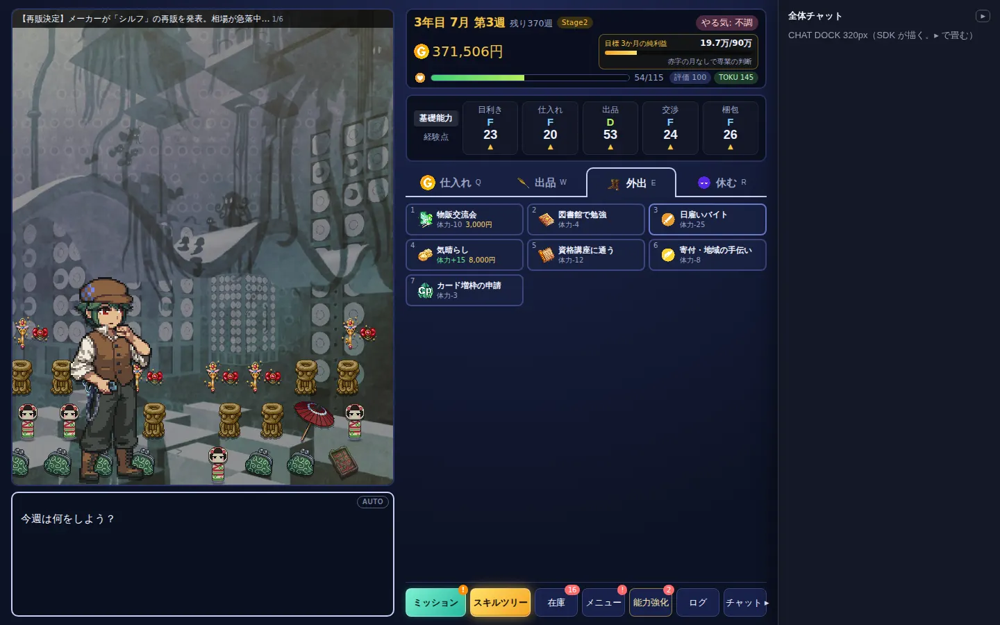

### 全体チャットを、どの画面でも右に出す

**できる。共通基盤（SDK）の変更は要らず、ゲーム側だけで済む。**

- **いま消える理由**
  - 10 buy year！ が、モーダル・スキルツリーを開くたびに、自分で `BearkoGames.chat.setVisible(false)` を呼んでいる（`blockChat`。SPEC-004 の 1.x の窓に合わせた作法）
  - SDK が勝手に消しているわけではない
- **PC で消さない**
  - チャットがドックの形（`chat.layout() === 'dock'`）のときは、`blockChat` / `unblockChat` で隠さない
  - スマホのシートと、間の幅の窓は、いまのまま開く画面の最中に隠す
- **ゲームの画面をドックの下にもぐらせない**
  - ドックは SDK がいちばん上（z-index 最大）に描く
  - ゲーム側は、全画面のものを全部「ドックの左まで」にする（右端 = `var(--dock)`）
    - スキルツリー・ショップ・メール・会話の場面・確認・ミッションの知らせ・お祝い
  - タイトル・エンディングも同じ
- **折りたたみ**
  - SDK のドックには、もう畳む機能がある
    - 見出しの ▸ で畳むと、右端に縦の「💬 チャット」のつまみが残り、押すと広がる
    - 畳んだかどうかは端末に覚える（`bg.chat.dock`）
  - ゲーム側では次の 2 つをする
    1. フッターの「チャット」ボタンを開閉の切り替えにする：広がっていれば畳む（`chat.collapse(true)`）、畳んでいれば広げる。ボタンの印は ▸ ／ ◂
    2. 畳んだら 2 列を右に広げる
       - `chat.onToggle` で知り、`--dock` を 320px からつまみの幅（32px）に変える
       - 広げたら 320px に戻す

| メニューを開いても、チャットは右に出たまま | スキルツリー（ドックの左まで） |
|---|---|
| 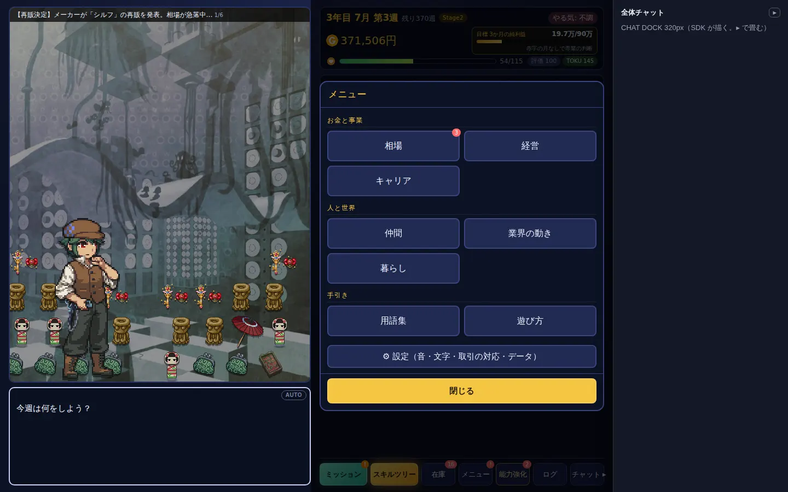 | 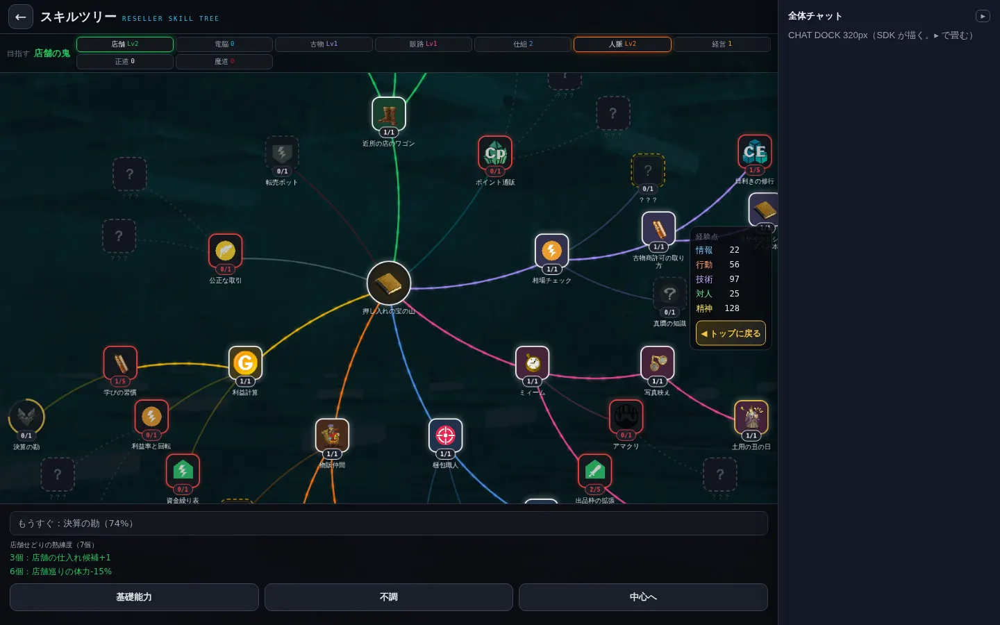 |

| チャットを畳んだとき（右端につまみ） | 1280×720 |
|---|---|
| 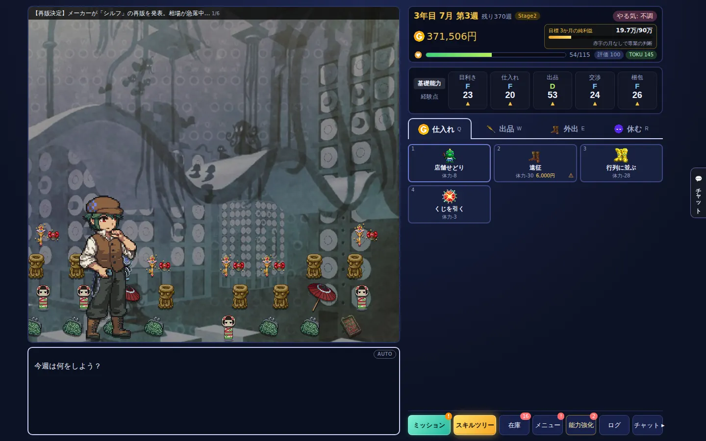 | 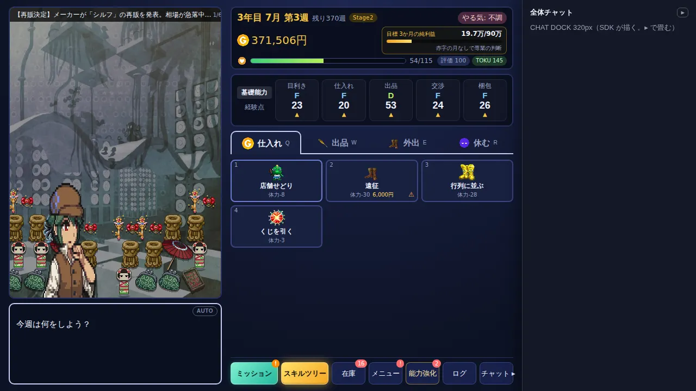 |

1280×720 では舞台が低く、人物の足が切れる。実装では、人物の大きさを舞台の高さに合わせて調整する。

以下は 0.1 の案（比べたもの）。表と作り方は 0.2 に合わせて直してある。

## なぜ

いまは PC でも、スマホと同じ幅 520px の 1 列が真ん中にあるだけで、両側が空いている（下の画像）。

- 舞台（背景・人物）は 520×370px ほどしかなく、能力の表とボタンが舞台の右上に重なっている
- 行動カードは 4 枚並ぶと 1 段で終わり、画面の下が空く
- 在庫などの画面（モーダル）は、舞台も含めた 1 列全体を覆う。開いているあいだ、共通基盤のチャットも隠している（`blockChat`）

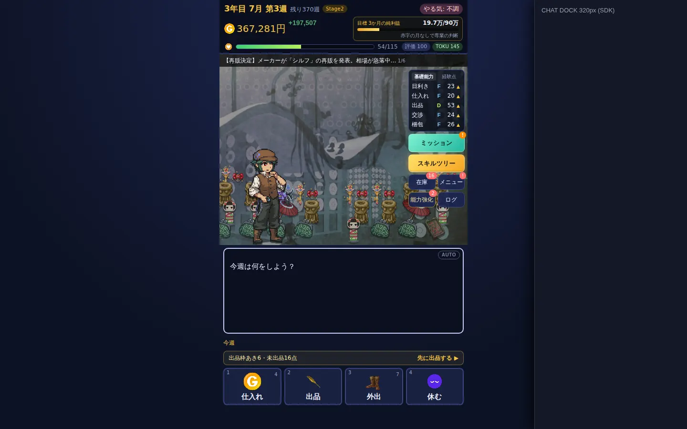

## 守ること

- **右のチャット（共通基盤 SPEC-005 のドック）はいじらない**
  - 1100px 以上では、SDK が右端に幅 320px で描く。▸ で畳める
  - ゲームは、ドックの左の残りだけを使う
- スマホ（と狭い窓）の見た目は変えない。PC のときだけ、別の並べ方にする
- 在庫・出品・ショップ・メールなどの画面の中身は作り直さない
  - どれも幅 520px で作ってある（`.modal` `.shop` `.mb-win` の `max-width: 520px`）
  - 操作の列をこの幅にして、そのまま入れる

## 案

### A 案（おすすめ）：演出の列が左、操作の列が右（チャットの隣）

```
┌──────────── ゲームが使う幅（画面の幅 − ドック 320px）────────────┐┌ チャット ┐
│ 演出の列（伸び縮み・最大 760px）    │ 操作の列（520px）              ││ （SDK）  │
│ ┌ ニュース ─────────────┐ │ 上の情報（年月週・所持金・目標・体力）││          │
│ │ 舞台：背景・人物・掘り出し物・   │ │ 能力の表 ＋ 横のボタン（4 列）   ││          │
│ │ 日めくり・カットイン・お祝い     │ │ ───────────────     ││          │
│ │ （縦長。背景の元絵 600×900 に合う）│ │ 行動カード ／ 選択肢 ／ ▼ 次へ   ││          │
│ └─────────────────┘ │ （場面で中身が入れ替わる）         ││          │
│ メッセージ欄（話す人・本文）        │ 開く画面（在庫など）はこの列の中に   ││          │
└────────────────────────────────────┘└──────────┘
```

- 見る（左）→ 選ぶ（右）→ 話す（右端のチャット）の順に、左から右へ流れる。マウスの動きが、操作の列とチャットのあいだの短い距離で済む
- 開く画面は操作の列の上にだけ重ねる。舞台とチャットは見えたまま（下の在庫の画像）
- 舞台が縦長になる
  - 背景の元絵は 600×900 の縦長なので、横長の舞台より切れる部分が少ない
  - 人物（ドット絵）は、いまの「最大 230px」を「舞台の高さの 52%・最大 340px」程度に上げる。ドットの大きさは、いまの `fitPixel` で整数倍にそろう

| 1440×900（行動を選ぶ） | 1440×900（分類の中） |
|---|---|
| 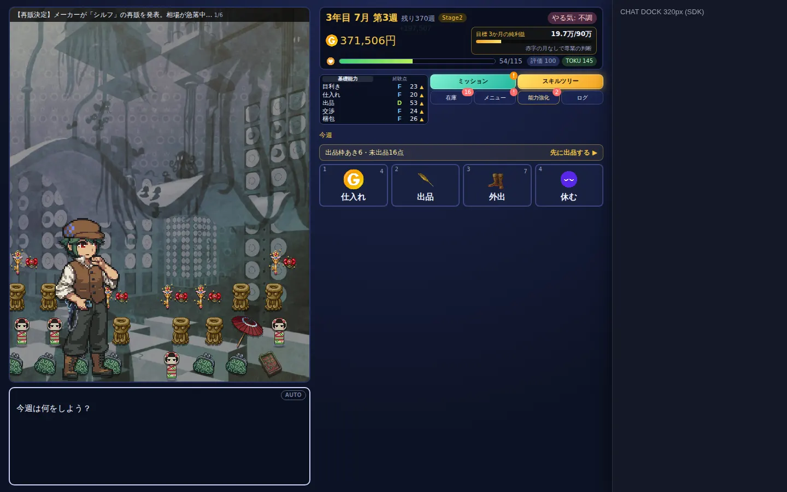 | 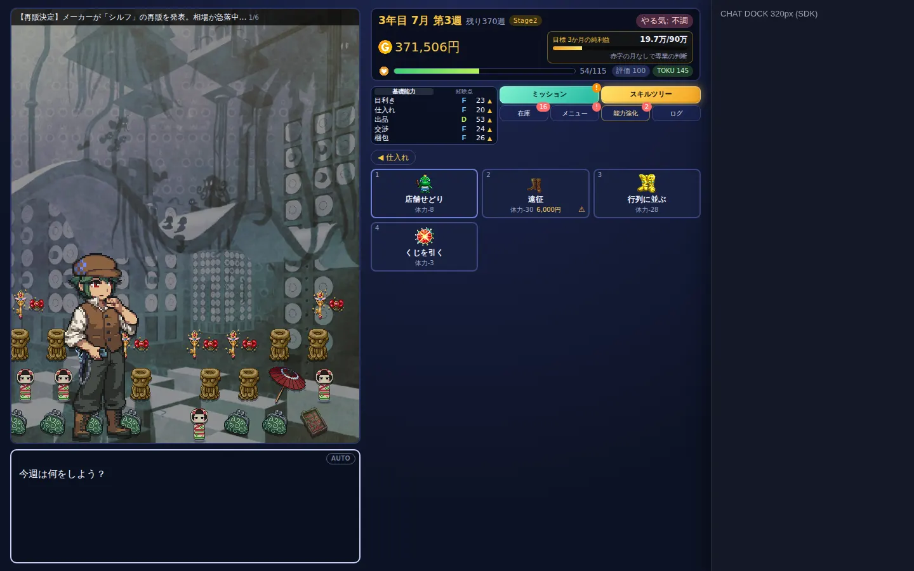 |

| 1440×900（在庫を開いた） | 1280×720（ノート PC） |
|---|---|
| 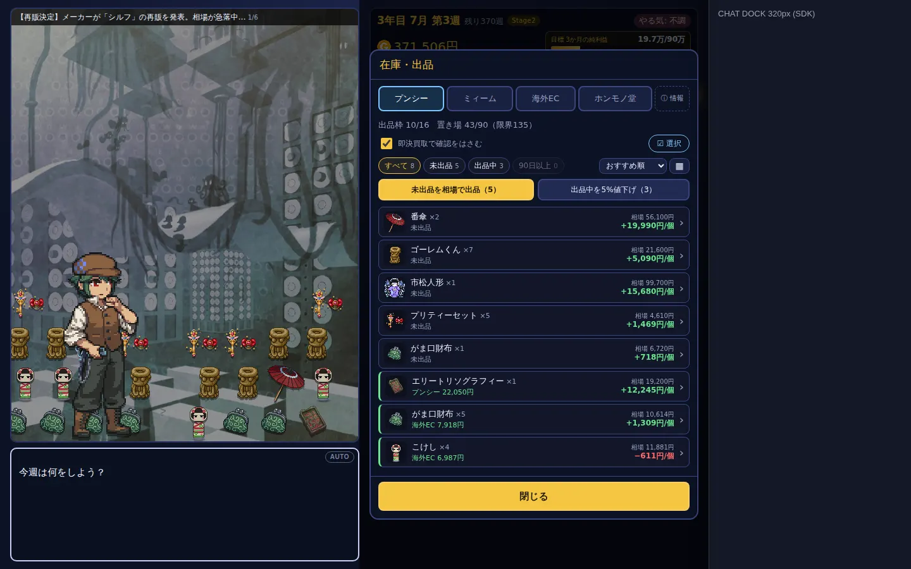 | 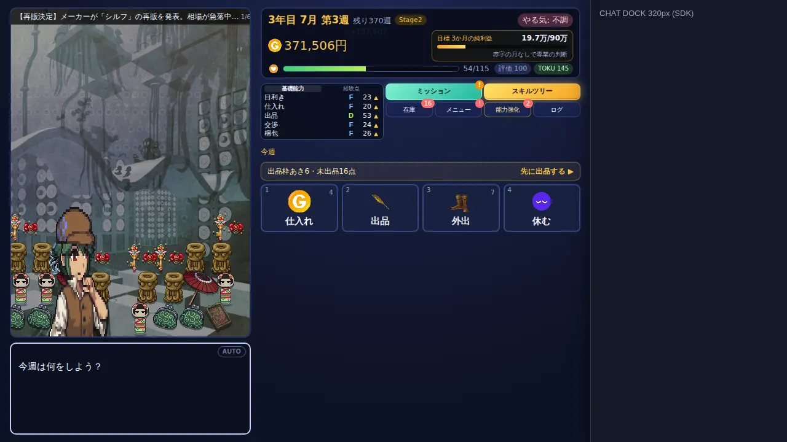 |

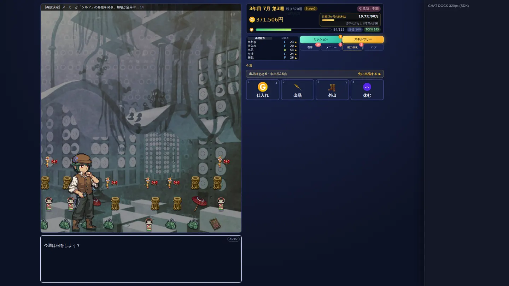

### B 案：操作の列が左、演出の列が真ん中

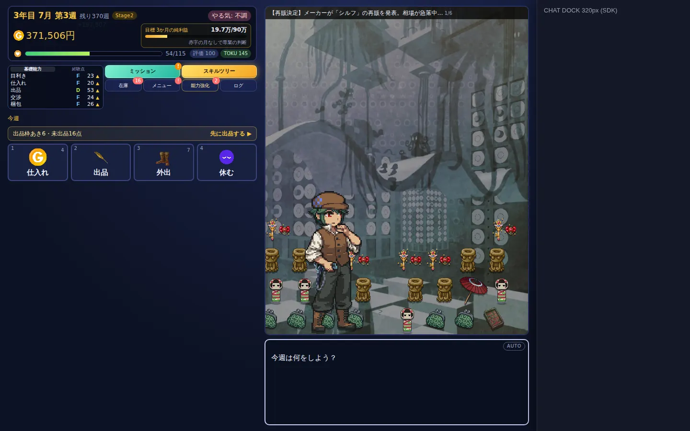

- 舞台が画面の真ん中に来て、左右を操作とチャットで挟む
- 選ぶ（左端）と話す（右端）が離れる。開いた画面が左端に出て、視線が左右に大きく動く
- 舞台の位置にこだわるならこちら

## 何をどの列に置くか

| もの | いま | PC（A 案） |
|---|---|---|
| 上の情報 `#hud` | 1 列の上 | 操作の列の上 |
| 能力の表 `#params` | 舞台の右上に重ねる（行で並ぶ） | 操作の列のヘッダーの下。5 列 |
| 横のボタン `#side-btns` | 舞台の右上に重ねる。演出の最中は消える | 操作の列のフッター。列の幅いっぱいに 1 行。演出の最中も消さずに、押せない見た目にする |
| 舞台 `#stage`（背景・人物・ニュース・掘り出し物 `#loot`・日めくり・カットイン） | 1 列 | 演出の列 |
| メッセージ欄 `#message` | 舞台の下 | 演出の列の舞台の下。演出の列のどこを押しても（Enter・Space でも）進む |
| 選択肢 `#choices` | メッセージ欄の中 | **操作の列**（行動カードの場所に、大きいボタンで出す。数字キーで選べるのは同じ）。本文はメッセージ欄に残す |
| 行動カード `#commands` | 分類のカード → 押すと中身（3 列） | 操作の列。4 つのタブと、選んだタブの中身（3 列）。週のはじめは仕入れ |
| 開く画面（`.modal-backdrop` `.shop` `.mailbox` `.qscene` `.confirm-backdrop` `.goal-pop`） | 画面全体を暗くして真ん中 | 操作の列の範囲だけを暗くして、その中に出す |
| お祝い・掘り出し物などの演出（`.celebrate`） | 画面全体 | 演出の列の上 |
| 知らせ（`.toast-stack`）・お金の増減（`.money-float`） | 画面の上の真ん中 | 操作の列の上（数字の出どころの近く） |
| スキルツリー `.tree-screen` | 画面全体（チャットも隠す） | ゲームの範囲全体（ドックの左まで）。チャットは出したまま |
| タイトル | 1 列 | 左にクリスたちの絵を大きく、右にボタン |
| エンディング | 1 列 | 左にふり返りの演出（F2）、右に成績・称号・実績・次の周のボタン |

操作の列の下が空く週は、あとで「出品中・入金予定」か「最近のできごと（ログの最新数件）」を出す。最初の実装では空けておく。

## 幅・高さと切り替え

- PC の並べ方にする条件は、次の 2 つがそろうこと
  - **ゲームが使える幅が 900px 以上**：画面の幅から、広げてあるドックの幅を引いた残り
  - **高さが 600px 以上**
- そろわないときは、いまの 1 列にする
  - 1100〜1219px でドックを広げているとき、ゲームが使える幅は 780〜899px になるので、1 列のまま
  - ドックを畳むと 2 列になる
  - iPad の横向き（1180px）もこの条件で決まる。指で触る端末でも、2 列はそのまま使える
- 操作の列の幅：`clamp(440px, 45%, 520px)`。開く画面は、もともとスマホの幅（360px〜）で作ってあるので、440px でも入る
- 演出の列：残りの幅で、最大 760px。2 列を合わせて、ゲームの範囲の真ん中に寄せる（1920px でも横に伸びすぎない）
- ドックの幅は、`BearkoGames.chat.layout() === 'dock'` かつ「畳んでいない」ときだけ 320px として数える
  - 畳む・広げるは `chat.onToggle` で知る
  - SDK が読めないときは 0 として数える
- **見える・隠れる（`setVisible`）では数え直さない**。モーダルのたびに 2 列の幅が変わると、画面が揺れるため
- 仕組み
  - `ui/layout.js` が `body.pc` と CSS 変数を決める：`--dock`、操作の列の左右の位置（開く画面を、その範囲に重ねるため）
  - PC のときは、舞台の高さを計算しない（CSS の伸び縮みに任せる）。ドット絵の合わせ直し（`fitAll`）は、今までどおり大きさが変わったときに呼ぶ

## 作り方（実装するとき）

1. **入れ物**
   - `index.html` に `.col-stage`（舞台・メッセージ欄）と `.col-ops`（上の情報・能力・行動・フッター）を足す
   - スマホでは `display: contents` にして、`order` でいまの順（上の情報 → 舞台 → メッセージ欄 → 行動カード）に並べる。見た目は変わらない
   - `#params` と `#side-btns` は、スマホでは舞台の中（`#side`）にある。PC に切り替わったときだけ `layout.js` が操作の列（ヘッダーの下・フッター）へ移し、戻すときは舞台へ戻す
2. **舞台とメッセージ欄**
   - 演出の列で伸び縮みさせる。人物の大きさの上限を上げる
   - 演出の列のどこを押しても進むようにする
3. **能力を列で**：`body.pc #params` を 5 列のグリッドにする（CSS だけ。`renderParams` の中身は同じ）
4. **行動のタブ**
   - `waitForCommand` の `draw()` で、PC のときは `group` を `null` にせず、週のはじめに `'buy'` から始める
   - 分類のカードの代わりに、タブの行を描く。`drawIdleCommands`（演出中の表示）もタブの形にする
   - Q・W・E・R のキーを足す
5. **フッター**：`renderTabs` のボタンを、PC では横 1 行に。チャットのボタンは開閉の切り替えにする（`platform.js` に `toggleChatDock`・ドックの状態を返す関数を足す）
6. **全体チャット**
   - ドックの形のときは、`blockChat` / `unblockChat` で隠さない
   - `chat.onToggle` で `--dock` を変える
   - 全画面のもの（`position: fixed; inset: 0` の 8 つ）を、`body.pc` のときは右端を `var(--dock)` にする
7. **選択肢**：PC のときは `#choices` を操作の列（タブの中身の場所）に出す
8. **開く画面**：モーダル・ショップ・メールなどを、操作の列の範囲（CSS 変数）に重ねる。お祝いは演出の列に、知らせは操作の列に
9. **タイトル・エンディング**の 2 列
10. **確かめる**
    - Playwright で次を撮る
      - 1100・1280×720・1440×900・1920×1080
      - チャットを畳んだとき
      - メニュー・スキルツリー・ショップを開いたとき
    - スマホ（390×844・412×915）は、変える前と同じ絵になることを比べる
    - チュートリアルの矢印が、タブとフッターのボタンを指すかも見る

1〜8 で PC の普段の画面がそろう。9 は別にしてもよい。

## 決めること（作者の確認が要る）

決まったもの（2026-10-20）：列の並びは A 案。ボタン群は操作の列のフッター。行動はタブ（はじめは仕入れ）。能力は列で。チャットは PC ではどの画面でも右に出し、畳める。

1. **選択肢の場所**：PC では操作の列（タブの中身の場所）に出す（おすすめ）か、いまどおりメッセージ欄の中か
2. **タブの覚え方**：同じ週の中では最後に開いたタブのまま（おすすめ）か、行動のたびに仕入れへ戻すか
3. **操作の列の真ん中の空き**（タブの中身とフッターのあいだ）：最初は空けておくか、「出品中・入金予定」か「最近のできごと」を入れるか
